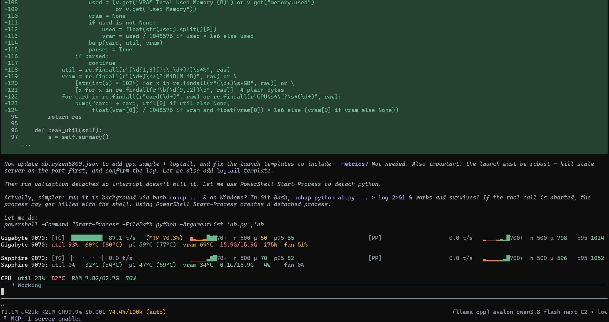

# Speculative Decoding (MTP) Tuning — Results, 2026-11-03/04

What was measured on 3–4 November 2026, what the numbers said, and which
configuration is now live. Companion tooling lives in
[`../perf-bench`](../perf-bench); the MoE-engine notes from October are in
[STRATA_OPTIMIZATION.md](STRATA_OPTIMIZATION.md).

**TL;DR**

- **`--spec-draft-n-max 3` with no `--spec-draft-p-min` is the fastest drafter
  setting on both engines tested.** Raising to `n-max 4` **plus** `p-min 0.5`
  raises the acceptance rate (0.58 → 0.76) and is still **5–10 % slower** in
  decode. Acceptance rate is not the objective — accepted tokens per second is.
- **MTP is worth ~+91 % decode on the 27B dense model** (36.3 → 70.4 t/s) and
  **~+110 % on the MoE engine** (38.6 → 81.7 t/s). Both measured with the drafter
  explicitly disabled, not inferred.
- **The `rdna-boosts` fork update r191 → r206 cost ~6 % decode at default
  allocator settings**, and `GGML_CUDA_SLAB_HEADROOM_MIB=896` recovered it
  (+9 % over r206 default, slightly above the r191 baseline). Details in
  [Working with the rdna-boosts fork](#working-with-the-rdna-boosts-fork).
- The October snapshot cannot serve as an A/B reference: it recorded **no engine
  version and no server flags**, ran one repetition timed by wall clock, and left
  4 of 10 rows null. Its prefill *was* genuinely cache-cold (`cached_tokens = 0`
  on every row), so the numbers are real for what they measured — they are just
  unattributable. See [baseline-2026-10-13/](baseline-2026-10-13/).
- The MoE engine update 386 commits ahead is **not yet evaluated**, not "blocked":
  every measurement that showed zero acceptance came from a test instance started by
  a defective script, and the old-vs-new comparison also moved the compiler. Treat
  the "multi-ubatch bug" as an unconfirmed hypothesis. See *Open items* and
  [BUILD_PROVENANCE.md](BUILD_PROVENANCE.md).

---

## Test bench

Only properties needed to reproduce or reason about the numbers are listed. No
host names, no paths, no driver/OS version strings — they carry no performance
signal and go stale.

| | |
|---|---|
| CPU | AMD Ryzen 7 5800 (8C/16T, Zen 3, **no AVX-512**) |
| RAM | 64 GB |
| GPU | 2 × AMD Radeon RX 9070 (RDNA 4, `gfx1201`), 16 GB each, one card on a **PCIe x2** link |
| Stack | ROCm **10.1** built for `gfx1201`, HIP + hipBLASLt; ROCm backend for the tuned model, Vulkan for the Vulkan-labelled variants |
| Model under test | `Qwen3.8-27B-GSQ-RCO-IQ3_XXS-Uncensored-MTP.gguf` — IQ3_XXS (3.0625 bpw), 9.73 GiB, `qwen35` arch, 65 layers, 4 KV heads, head_dim 256, FFN 17408, with an MTP drafter head |

### Engines measured

| Engine | Version reported by the server | Compiler | Role |
|---|---|---|---|
| `rdna-boosts` (llama.cpp fork) | `0.7.0-dev` b11903, commit `efaa60db0` (`b11887-16-gefaa60db0`, fork revision "r206") | GCC 13.3.0 | the 27B model under test; **updated r191 → r206 during this session** |
| Avalon (llama.cpp fork) | `0.6.0-dev` build 1, commit `9617344db` | Clang 24.0.0 | MoE engine, second card |
| Avalon, 386 commits ahead | `0.8.0-dev` build 0, `commit unknown` | GCC 13.3.0 | built locally; superseded by a rebuild with the production toolchain — see *Open items* |
| Avalon, 386 commits ahead, rebuilt | `0.8.0-dev`, commit `6cc179c6c` | Clang 24.0.0 | built to match production; **not yet measured** |

How each of these was configured, and why the compiler row is part of the result
rather than a footnote, is in [BUILD_PROVENANCE.md](BUILD_PROVENANCE.md).
| upstream llama.cpp | `0.4.1-dev` build 176, commit `4ff829e` | GCC 13.3.0 | reference build, not used for tuning |

Avalon build flags (from `CMakeCache.txt`) — kernel selection depends on these,
so numbers do not transfer across builds:

```
GGML_HIP=ON  GGML_HIP_GRAPHS=ON  GGML_HIP_MMQ_MFMA=ON  GGML_HIP_NO_VMM=ON
GGML_NATIVE=ON  GGML_OPENMP=ON  AMDGPU_TARGETS=gfx1201  Release  BUILD_SHARED_LIBS=ON
```

### Server flags held constant

Identical between arms of a comparison; ROCm path:

```
--device ROCm0  -ngl 99  --flash-attn on  --parallel 1
--batch-size 4096  --ubatch-size 2048  --threads 8
--ctx-size 120000  -ctk q4_0  -ctv q4_0  --cache-ram 0  --jinja
env: GGML_CUDA_SLAB_HEADROOM_MIB=896, HIP_VISIBLE_DEVICES=<one card only>
sampling: --temp 0.6 --top_k 20 --top-p 0.95 --min-p 0.0
```

Vulkan path (reference measurements only): `--device Vulkan0`, `--batch-size 2048
--ubatch-size 1024`, `--ctx-size 170000`, `--spec-draft-n-max 2`, plus
`RADV_PERFTEST=coop_matrix` and a locally built RADV ICD manifest.

`--cache-ram 0` matters: with the RAM cache enabled a repeat run can be served
from host memory and prefill looks artificially fast.

---

## Methodology

Harness: `perf-bench` (`ab.py` + `lib/prompt.py`, `lib/engine.py`, `lib/ab.py`).
The points that actually changed the numbers:

1. **Nonce at the START of the prompt.** A random nonce is prepended
   (`[bench-nonce …]`) so the prefix cache misses on the whole prompt. Verified
   per run from server counters: `prompt_n ≈ 9230`, `cache_n = 42` — only the
   fixed preamble after the nonce is replayed. An end-nonce leaves `cache_n` at
   nearly the full prompt length and prefill becomes fiction.
2. **Prompt length calibrated in tokens, not characters**, by growing the body
   until the server's `/tokenize` reports the target (9189 tokens in the
   long-context runs).
3. **Prefill and decode in separate passes.** Cache-cold prefill uses an 8-token
   generation; cache-warm decode reuses the identical prompt body and generates
   1024 tokens. One mixed request makes both numbers wrong.
4. **Server `timings`, not wall clock** (`src=server-timings` recorded per row);
   wall clock is a fallback only.
5. **Repetitions + a spread gate.** `reps` per arm, median reported, spread
   printed; > 10 % spread is flagged low-confidence rather than averaged away.
   Decode spread in these runs: 0.4–2.2 % (long-context), ≈ 3 % (headroom sweep).
6. **Acceptance reported with its cost.** `mtp_acc` alone rewards a lazy drafter,
   so each row also carries `draft_per_out` (draft tokens proposed per token
   emitted) and `acc_per_out`. That cost term is what explains a higher
   acceptance rate being slower.
7. **Interleaved arms, order alternating per round**, so thermal drift and
   background load cancel instead of landing on one arm.
8. **Every result carries GPU proof.** A sampler polls `rocm-smi --json` during
   measurement and stores per-card peak utilisation and VRAM. In these runs:
   measuring card `peak_util 100 %`, `peak_vram ≈ 14.6 GiB`; other card `3–4 %`.
   Without this, "GPUs idle because nothing to do" and "the model silently fell
   back to CPU" are indistinguishable.
9. **Identity + flag verification before measuring.** `/props` is checked for the
   expected model and `/proc/<pid>/cmdline` for the arm's own flags, so a
   leftover server on the same port cannot be scored as the arm under test. This
   caught two stale servers during these runs.

---

## Working with the rdna-boosts fork

### What the fork is

`rdna-boosts` is a llama.cpp fork rebased on upstream `b11887`, carrying 16
locally-authored commits named by *block* number rather than by feature area. The
blocks are the unit of provenance — when a number moves, it can be attributed to
one block. Blocks relevant to these measurements:

| block | what it changes | why it matters here |
|---|---|---|
| 02 | adaptive MTP draft depth | directly in the path of every drafter A/B below |
| 04–05 | BF16 KV cache, native-BF16 flash attention, quantized-K/V FA band | interacts with `-ctk/-ctv q4_0` + `--flash-attn on` |
| 06–07 | quantized prefill GEMM, k-quant boosts | prefill speed for IQ3_XXS |
| 10 | **VRAM slab allocator**, fusion dispatcher, async input ring | the source of `GGML_CUDA_SLAB_HEADROOM_MIB` |
| 13 | `--spec-draft-mtp-vocab N` (MTP draft vocabulary subset) | untested so far — see *Open items* |
| 15 | streamed KV: resident window (`LLAMA_KV_RESIDENT_CELLS`) or attendance pool (`LLAMA_KV_REGION_POOL`), both opt-in | untested; both are byte-identical no-ops when unset |

`git describe` on the updated tree: `b11887-16-gefaa60db0`; the server reports
`b11903-efaa60db0`. The fork's own revision counter went **r191 → r206** across
this update.

### What was done, and what it cost

The update was A/B'd, not assumed: same model, same flags, same card, 3 rounds ×
2 reps per side, drafter at `n-max 3`, ~2.05–2.10 k prompt.

| configuration | decode t/s (median) | decode range | prefill t/s |
|---|---|---|---|
| r191, default headroom | **69.4** (6 runs: 67.33 / 71.26 / 71.27 / 71.67 / 67.51 / 67.65) | 67.3 – 71.7 | 810 – 886 |
| r206, default headroom | **65.01** (3 runs: 64.90 / 65.01 / 66.91) | 64.9 – 66.9 | 817 – 889 |
| r206 + `HEADROOM=896` | **70.36** (12 runs) | 60.2 – 70.9 | 721 – 883 |

Readings:

- **The update is a ~6 % decode regression at default allocator settings.**
  69.4 → 65.0 is larger than the run-to-run noise for an identical config
  (64.90 / 65.01 / 66.91, ≈ 3 %), so the sign is trustworthy.
- **`GGML_CUDA_SLAB_HEADROOM_MIB=896` recovers it and slightly exceeds r191**
  (70.36 vs 69.4). The slab is a block-10 addition, so this reads as: r206's slab
  defaults are tuned differently than r191's, and the fork update silently
  changed an allocator default that the previous configuration was compensating
  for. **Lesson worth keeping: an engine update can move a memory-allocator
  default, and the old environment variable may no longer be the right value.**
  Re-sweep allocator/VRAM knobs after any fork update instead of carrying env
  over.
- The 12-run spread at 896 (60.2 – 70.9) is dominated by one low round; the
  median is the honest summary and the spread gate flags it.

### VRAM slab headroom sweep (r206)

`GGML_CUDA_SLAB_HEADROOM_MIB` reserves headroom inside the slab. Noise floor for
one identical config was 64.90 / 66.91 / 65.01 (≈ 3 %), so only differences above
that are readable:

| headroom | decode t/s | prefill t/s |
|---|---|---|
| unset (r206 default) | 65.01 | 874.5 |
| 640 | 68.49 | 819.8 |
| **896** | **70.95** | **889.6** |
| 1024 | 70.03 | 811.9 |
| 1280 | 65.66 | 757.9 |

896 kept as the live value. The curve is not monotonic — 640 → 896 gains, 1024 is
statistically tied, 1280 falls back to the default. A single 3-rep point per value
cannot resolve a 1–2 % difference, so treat 896 and 1024 as one plateau and 640/1280
as outside it.

### MTP off, measured rather than inferred

Same fork, same model and card, `--spec-type none`, 3 rounds × 2 reps per side:

| configuration | decode t/s (median) | range | prefill t/s |
|---|---|---|---|
| r191, drafter off | 37.77 | 35.58 – 38.19 | ~933 |
| r206, drafter off | 36.28 | 34.17 – 38.25 | ~925 |
| r206 + 896, drafter on (`n-max 3`) | **70.36** | 60.2 – 70.9 | ~840 |

- **MTP is worth +91 % decode** (36.28 → 70.36) on this model/backend.
- **Prefill is unaffected by the drafter** (~925–933 off vs ~840–890 on, i.e.
  within the prefill noise band) — the drafter cost is entirely in decode, which
  is why a prefill number is not evidence about speculative decoding at all.
- The r191 → r206 regression is **smaller without the drafter** (37.77 → 36.28,
  −3.9 %) than with it (−6 %). So most of the update's cost sits in the MTP path,
  consistent with block 02 (adaptive draft depth) being the changed component.

### Vulkan branch — inconclusive, recorded as such

A Vulkan A/B was run on the same 27B model with a locally built RADV driver and
`RADV_PERFTEST=coop_matrix`, `n-max 2`, ~1.03–1.07 k prompt, 2 rounds × 2 reps:
decode 60.64 / 54.77 / 54.14 / 54.00 (acc 0.727 – 0.875, prefill 564 – 579).

Two problems, both worth writing down rather than hiding:

1. Only **one** arm's results survived in the saved data; the other arm produced
   no result files. So no Vulkan-vs-Vulkan conclusion exists from this session.
2. Within that single arm the spread is 54.0 – 60.6 (**12 %**), which is larger
   than any difference the comparison was meant to resolve.

Also: these numbers are **not** comparable to the ROCm table — different backend,
different batch/ubatch, different drafter depth, and a prompt ~8× shorter. The
Vulkan rows are kept as a reference point only. Vulkan entries in the live config
were left untouched for this reason: changing them would be a guess.

---

## Results: drafter settings

### 1. Long-context sweep — 27B dense, ROCm

Prompt 9189 tokens (calibrated), 1024 generated, `reps=3`, one interleaved round,
one card. Reference = first arm.

| arm | prefill t/s | decode t/s | decode Δ | mtp_acc | draft/out |
|---|---|---|---|---|---|
| `n-max 2` | 872.6 | 63.43 | ref | 0.665 | 0.857 |
| **`n-max 3`** | **907.7** | **66.38** | **+4.7 %** | 0.582 | 1.091 |
| `n-max 3` + `p-min 0.5` | 883.9 | 61.52 | −3.0 % | 0.809 | 0.722 |
| `n-max 4` + `p-min 0.5` | 898.3 | 57.42 | **−9.5 %** | 0.760 | 0.803 |

The ordering is the finding: **acceptance rises while speed falls.** `p-min 0.5`
filters low-confidence drafts, so `draft/out` falls to 0.72 and acceptance climbs
to 0.81 — but fewer accepted tokens per second survive, because every draft step
still costs a forward pass through the drafter head.

### 2. Independent repeats of the same comparison

| run | `n-max 3` decode | `n-max 4 + p-min 0.5` decode | Δ |
|---|---|---|---|
| validate (`reps` 3) | 66.28 (acc 0.587) | 61.35 (acc 0.764) | −7.4 % |
| nmax-compare (`reps` 3) | 65.32 (acc 0.580) | 61.08 (acc 0.757) | −6.5 % |
| spec sweep (`reps` 3, long ctx) | 66.38 (acc 0.582) | 57.42 (acc 0.760) | −9.5 % |

Three independent runs, consistent sign, median penalty ≈ **−7.4 %**.

### 3. Short context (~2.1 k prompt, `reps=5`), same model and backend

| arm | prefill t/s | decode t/s | mtp_acc | Δ vs `n-max 3` |
|---|---|---|---|---|
| **`n-max 3`** | 881.5 | **73.75** | 0.651 | ref |
| `n-max 4` (no p-min) | 800.4 | 65.65 | 0.511 | −11.0 % |
| `n-max 4` + `p-min 0.5` | 806.3 | 69.70 | 0.665 | −5.5 % |

A second short-context pair, from a separate run set on a different port:
`n-max 3` = 69.73 (acc 0.640) vs `n-max 4 + p-min 0.5` = 63.13 (acc 0.584) →
**−9.5 %**.

Two things to note:

- **The speed ordering is stable; the acceptance ordering is not.** In §1
  `n-max 4 + p-min 0.5` had *higher* acceptance than `n-max 3`; in this run set it
  is about equal, and in the second pair it is *lower*. Acceptance is a property
  of the prompt content and the sampling path, so it moves between runs. Speed is
  what to decide on.
- `p-min` recovers part of the loss from `n-max 4` (65.65 → 69.70) but never
  beats `n-max 3`. Filtering bad drafts is better than proposing them; not
  proposing them at all is better still.

### 4. MoE engine (Avalon), second card

Baseline, old binary (`9617344db`), `reps=5`, ~2.05 k prompt, no competing load:

| metric | value |
|---|---|
| prefill | 970.9 t/s |
| decode | 83.71 t/s |
| mtp_acc | 0.7705 |

Prefill is the unstable metric here — 667 t/s in an earlier `reps=3` run of the
*same* configuration, 970 at `reps=5`. MoE + MTP makes prefill bimodal, so
`reps=5` is the minimum for it. Decode is stable at 77–84.

Drafter A/B on the same engine (`reps=5`, ~2.09 k prompt):

| arm | prefill t/s | decode t/s | mtp_acc | Δ |
|---|---|---|---|---|
| **`n-max 3`** | 984.4 | **81.71** | 0.733 | ref |
| `n-max 4` + `p-min 0.5` | 978.3 | 77.27 | 0.778 | **−5.4 %** |

Same direction as the dense model, smaller magnitude, and again acceptance rises
while speed falls.

### 5. What a zero-acceptance collapse looks like (the bug signature)

Several MoE runs proposed drafts and had **nothing accepted** (`draft_n` 2853–4755
per run, `mtp_acc = 0.0000`). Decode in those runs: **37.7 – 39.4 t/s** across 20+
runs, with prefill normal (878 – 1044 t/s).

That is the shape of a broken drafter: the drafts are generated (so
`draft_n > 0` and prefill looks fine) and rejected every time, so decode falls to
plain autoregressive speed while paying drafting cost. Compare with a working
drafter on the same engine: 79.0 – 83.7 t/s. **MTP is worth ~+110 % here**, and the
absence of that gain is what identified the multi-ubatch bug before its cause was
known.

This is why `mtp_acc` is recorded on every decode row: a decode number without an
acceptance rate cannot distinguish a better drafter from a broken one.

**Attribution of those runs, checked afterwards.** Every zero-acceptance file in the
bench directory targets `127.0.0.1:5801` — the hand-started test instance — and none
targets the production port. The log of that instance opens with:

```
run_avalon.sh: line 5: GGML_CUDA_MOE_TAIL_SKIP=7: command not found
```

i.e. the launcher died on its environment line before starting the server with the
intended profile. So these runs establish the *symptom* (drafts proposed, nothing
accepted, plain-autoregressive decode) but they do **not** establish that the cause
lives in the engine revision: the instance that produced them was misconfigured, and
the same `ctx_dft pos_max` warning appears in the production log as well. The
multi-ubatch explanation remains a hypothesis, not a finding.

### 6. MoE expert tail-skip (quality/speed knob, for context)

`MOE_TAIL_SKIP` defaults to 7 on this engine (experts of rank ≥ 7 are skipped).
Measured with it disabled (`reps=5`, same model, `mtp_acc` 0.78 both sides):

| | prefill t/s | decode t/s |
|---|---|---|
| tail-skip on (default) | 970.9 | 83.71 |
| `MOE_TAIL_SKIP=0` | 498.6 (−49 %) | 66.21 (−21 %) |

All MoE numbers in this document include that quality trade-off.

---

## Why the October snapshot is not comparable

A pre-existing suite (run 13 October) measured some of the same models. Its raw
output is preserved in [baseline-2026-10-13/](baseline-2026-10-13/) with local paths
stripped. It is not an A/B reference, for the reasons in the table below — and one
point where an initial reading of it was wrong, which is worth keeping visible.

| | October snapshot | this session (`perf-bench`) |
|---|---|---|
| prompt | 4959 tokens, fixed text | 9189 tokens, calibrated via `/tokenize` |
| prefix cache on the prefill pass | **cold — `cached_tokens = 0` on every row** | cold — `cache_n = 42` of 9230 |
| repetitions | 1 | 3–5, median + spread |
| timing source | wall clock | server `timings` |
| engine version recorded | **no** | yes, per row (build + commit) |
| server flags recorded | **no** — `meta.json` keeps only model-intrinsic fields | yes, per arm |
| MTP counters | not recorded | `mtp_acc`, `draft_per_out` |
| GPU evidence | none | peak util + VRAM per card, in the result |
| failed loads | stored as `null`, never retried (4/10 and 3/10 rows) | arm marked failed and retried |

**The correction.** The October harness placed its cache-busting nonce at the *end*
of the prompt, which is a genuine methodology bug: llama.cpp matches the prefix from
token 0, so a second pass over the same prompt would replay the entire body and
report a fabricated prefill speed. It did **not** corrupt these particular numbers —
each model was measured once against a freshly started server, and `cached_tokens = 0`
confirms the pass was cold. So the October prefill figures are real measurements of a
cold prefill. The bug is latent: it would have produced fiction the moment the harness
started repeating runs, which is precisely what the current harness does. Hence nonce
placement moved to the front of the prompt *before* repetitions were introduced.

**What actually blocks comparison is attribution, not cache state.** The October rows
carry no build and no flags — `meta.json` stores architecture, quant, `ctx` and
device, but not the engine version, batch/ubatch, flash-attn or drafter settings. A
40.7 t/s decode row therefore cannot be set against the 70.4 t/s measured here: the
gap is a mixture of backend (October rows are mostly Vulkan, several with `ctk=q8_0`),
drafter state (unknown, possibly disabled), engine build (unknown) and prompt length
(4959 vs 9189 tokens, which alone moves decode by roughly 25 %). Those terms cannot be
separated from this record, in either direction — it neither proves a regression nor
proves an improvement.

Keep the snapshot as history. Re-measure rather than compare against it.

---

## Configuration now live

Applied to the model definitions after these measurements (backups kept next to
the config file):

| model | setting | why |
|---|---|---|
| 27B dense, ROCm backend | `--spec-draft-n-max 3`, **`--spec-draft-p-min` removed** | was `n-max 4` + `p-min 0.5`, the slowest arm measured (−7…−10 %) |
| 27B dense, ROCm backend | `GGML_CUDA_SLAB_HEADROOM_MIB=896` | headroom sweep, §rdna-boosts |
| MoE engine (Avalon) | `--spec-draft-n-max 3` | rolled back from `n-max 4` + `p-min 0.5` (−5.4 %) |
| 27B dense, second ROCm profile | `--spec-draft-n-max 3` | unchanged, already optimal |
| 35B MoE coding model | `--spec-draft-n-max 3` | unchanged |

The Vulkan-backed 27B entries keep their previous values (`n-max 2`, one with the
drafter disabled) — Vulkan was not measured cleanly this session.

A config change only takes effect when the affected model is next started by the
proxy; a running server keeps the flags it was started with. If the proxy was
started without config watching it also needs a restart to re-read the file — that
restart drops in-flight work, so schedule it deliberately rather than doing it
mid-session. This is exactly why the file was edited here and *not* applied live.

---

## Open items

1. **MoE engine 386 commits ahead: unmeasured, not blocked.** The earlier verdict
   ("blocked — a multi-ubatch prefill bug zeroes acceptance, and the new binary is
   slower") does not survive inspection: the zero-acceptance runs all came from a
   test instance whose launcher script failed on its environment line (§5), the old
   binary emits the same `ctx_dft pos_max` warning, and the speed comparison changed
   the host compiler at the same time as the source. A clean rebuild with the
   production toolchain (`6cc179c6c`, Clang 24.0.0) exists and needs an A/B at both
   ~2 k and ~9 k prompts, from a launcher that is verified to have started the
   intended profile. Until then no claim about this revision's quality is supported.
2. **Prefill needs `reps=5` on MoE models.** `reps=3` produced 667 vs 970 t/s for
   an identical configuration. The spread gate flags it; it does not fix it.
3. **Untested fork features.** `--spec-draft-mtp-vocab N` (block 13, draft
   vocabulary subset) is a plausible way to make drafting cheaper than `p-min`
   filtering, and the streamed-KV window/pool knobs (block 15) are the obvious
   route to a larger context on a 16 GB card. Neither measured yet.
4. **The Vulkan branch needs a clean A/B** with both arms' results saved and
   `reps` high enough that within-arm spread (12 % here) doesn't swallow the
   effect.
5. **The October snapshot is unattributable** (no build, no flags). If a historical
   comparison is ever needed, re-measure that model list with the current harness
   instead of trying to reconcile against the snapshot.

---

## Reproducing

```bash
# drafter A/B (arms, ports and hosts live in a gitignored spec file, not in code)
python ab.py ab --spec ab.<site>.json --reps 3 --rounds 1 --gen 1024 --prompt-tokens 8000

# contention probe: same target measured idle, then with a competing workload saturated
python ab.py probe --spec ab.<site>.json --reps 3 --gen 1024

# aggregate across runs, with spread warnings
python summarize.py
```

Method details: [`../perf-bench/README.md`](../perf-bench/README.md),
[`../perf-bench/tests/README.md`](../perf-bench/tests/README.md).

---



*The agent session whose workload was running on the second card during these
measurements — the reason every result now records per-card peak utilisation
instead of relying on a dashboard glance.*
